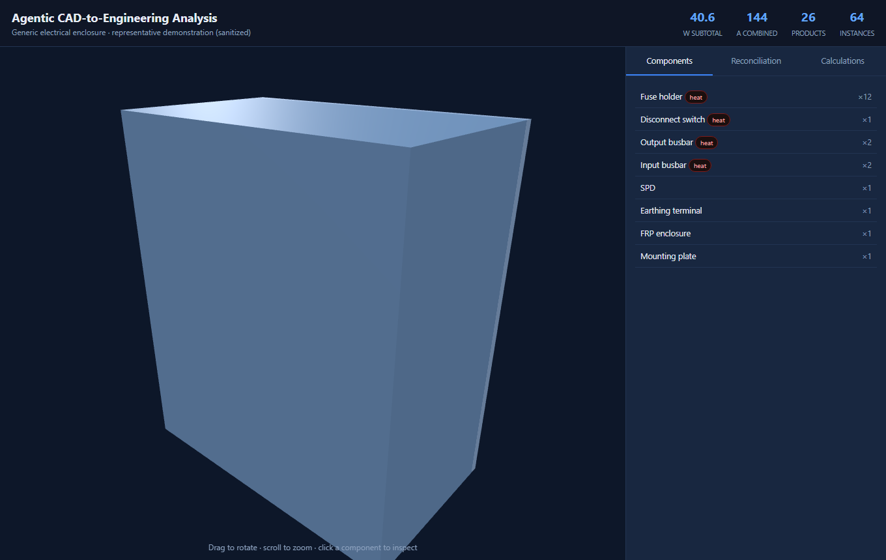
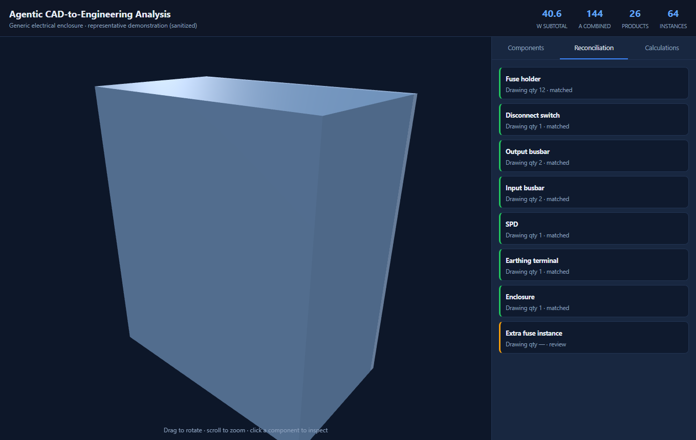
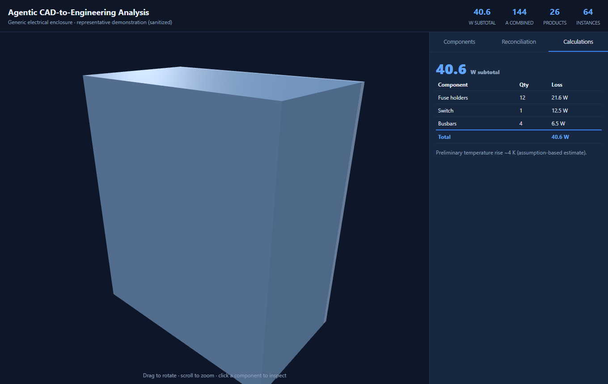
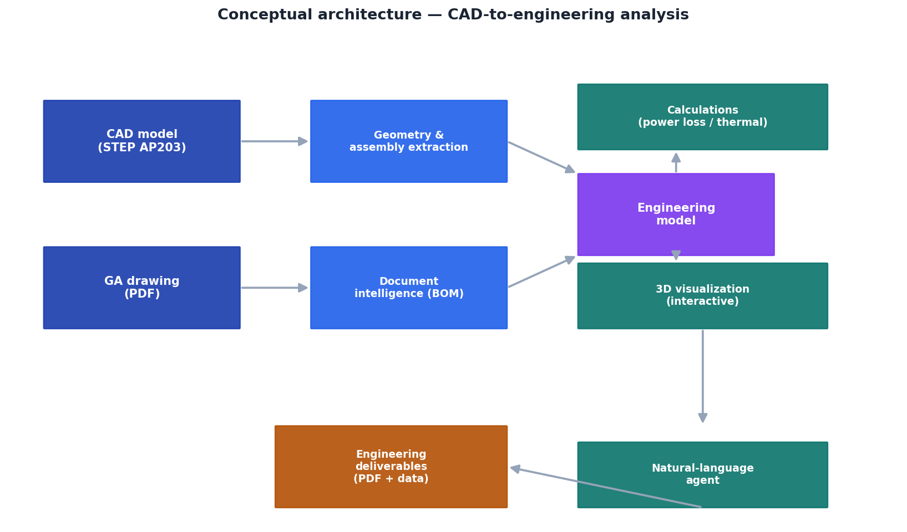

# Agentic CAD-to-Engineering Analysis

**Turn 3D CAD assemblies and engineering drawings into verified engineering deliverables — by describing what you need in plain language.**

A professional portfolio showcase of an application built with NebulaCloud Studio.

> **Notice**
> This repository is a public project showcase created using NebulaCloud Studio.
> The proprietary source code, implementation details, prompts, workflows, datasets, infrastructure, and deployment configuration are intentionally not included.

---

## 1. Overview

This application demonstrates an end-to-end, agentic engineering workflow. It ingests a real 3D CAD assembly (STEP) together with a general-arrangement (GA) drawing, interprets both, and produces engineering analysis that is traceable to source data.

An engineer can open the application, issue a natural-language instruction such as *"reconcile the bill of materials, calculate the declared power losses, and generate a report"* — and the application executes the required CAD, document, calculation, visualization, and reporting steps, then returns source-linked deliverables.

## 2. Business Problem

Manufacturers of electrical switchgear and enclosures rely on existing 3D CAD models (SOLIDWORKS, Creo, AutoCAD) and technical drawings. To answer a routine engineering question — *"what is the total heat load of this enclosure?"* or *"does this BOM match the 3D model?"* — engineers today must manually:

- Re-interpret the assembly structure and components.
- Read tables out of drawings by hand.
- Cross-check the drawing against the 3D model.
- Repeat calculations in spreadsheets or separate tools.

This is slow, error-prone, and disconnected from the models the organization already owns.

## 3. Solution Overview

The application connects the CAD model, the engineering drawing, the calculations, and the deliverables into one guided workflow:

1. **Direct CAD understanding** — import the STEP assembly, extract its hierarchy, components, dimensions, and placements.
2. **Drawing intelligence** — extract the GA bill of materials, quantities, ratings, and losses.
3. **CAD-to-GA reconciliation** — match expected components to identified geometry, with explicit *confirmed / inferred / review* states.
4. **Engineering calculations** — deterministic, unit-validated calculations with source traceability and safeguards.
5. **Interactive 3D inspection** — inspect, isolate, and select components; visualize heat sources.
6. **Natural-language execution** — describe the task and the tools execute it.
7. **Professional deliverables** — an engineering assessment report plus structured, reproducible outputs.

## 4. Live Demo

A standalone live demonstration is available at **`demo.html`** (open in any modern browser):

- A representative (sanitized) 3D electrical enclosure with generic components.
- Interactive inspection — rotate, zoom, and click any component to view its matched engineering information.
- Component inventory, CAD-to-GA reconciliation, and power-loss calculation panels.

The live demo uses sample data only and exposes no implementation details, customer data, or internal APIs.

## 5. Demo Video

A short walkthrough is available via the [live demo](demo.html): CAD import → drawing interpretation → component identification → calculations → 3D inspection → deliverables.

## 6. Project Screenshots

| View | Description |
|---|---|
|  | Consolidated 3D assembly with component color coding and selection |
|  | CAD-to-GA reconciliation with match status |
|  | Declared power-loss calculation with source traceability |
|  | Thermal-design readiness with preliminary estimate |
|  | Engineering report and structured outputs |

## 7. Generated Outputs

The application produces:

- **Engineering assessment report (PDF)** — inputs, methodology, calculations, observations, limitations.
- **CAD component inventory** — extracted assembly structure and classifications.
- **CAD-to-GA reconciliation report** — expected vs. identified quantities with confidence.
- **Power-loss register** — component-wise losses with data provenance.
- **Thermal assessment** — declared heat-load subtotal and a clearly-labelled preliminary temperature-rise estimate.
- **Interactive 3D visualization** — model with linked engineering information.

Representative (sanitized) examples are in [`assets/outputs/`](assets/outputs/).

## 8. Key Features

- Direct interpretation of STEP (AP203) assemblies — hierarchy, instances, dimensions, placements.
- Document intelligence for GA drawings (BOM tables, notes, title block).
- Automatic CAD ↔ drawing reconciliation with explicit exception reporting.
- Deterministic engineering calculations with unit validation and source traceability.
- Interactive WebGL 3D viewer — orbit/zoom/pan, component selection, isolation, heat-source and thermal views.
- Natural-language task execution against real tools (not canned answers).
- Professional, reproducible deliverables; all results traceable to the source files.

## 9. Intended Users

- **Design engineers** — inspect CAD, verify BOMs, review losses.
- **Thermal / application engineers** — assess heat load and thermal-design readiness.
- **Engineering managers** — review traceable, reproducible engineering deliverables.

## 10. Example Use Cases

- Enclosure and switchgear thermal load assessment.
- CAD-to-BOM reconciliation and design review.
- Solar combiner / array junction box verification.
- Automated generation of engineering assessment reports from existing CAD and drawings.

## 11. Technical Highlights (High-Level Only)

- STEP assembly parsing (product structure and instance counts).
- Boundary-representation geometry processing for visualization.
- Document table extraction from engineering drawings.
- Deterministic calculation engine with scenario safeguards.
- WebGL 3D viewer with per-component selection and view modes.
- Natural-language task router invoking real engineering tools.

## 12. Architecture Overview (Conceptual Only)



The application follows a conceptual pipeline:

```
CAD model (STEP)  ──►  Geometry & assembly extraction  ──┐
                                                         ├─►  Engineering model  ──►  Calculations ──►  Deliverables
GA drawing (PDF)  ──►  Document intelligence (BOM)  ────┘            │
                                                                     ├─►  3D visualization
                                                                     └─►  Natural-language agent
```

Component interaction is described conceptually; internal services, prompts, and runtime architecture are not disclosed.

## 13. Technical Scope & Limitations

- The demonstration reproduces *declared* component losses and reconciles the drawing against the CAD model.
- A *validated* temperature-rise result (e.g., IEC TR 60890 verification) requires additional inputs — ambient/installation conditions, manufacturer loss-vs-current characteristics, ventilation data, and temperature-rise test data. Where such data is absent, the application reports the gap and provides a clearly-labelled preliminary estimate from public-source assumptions rather than a fabricated result.
- Visualized heat maps represent *declared heat sources*, not a computed thermal field, unless a validated thermal simulation is performed.

## 14. Performance Summary (Verified Only)

| Metric | Value |
|---|---|
| CAD assembly import & interpretation | ✅ successful |
| Unique products / assembly groups extracted | ✅ reproduced independently |
| Declared heat-loss subtotal reproduced | ✅ exact |
| Operating-current reference reproduced | ✅ exact |
| CAD-to-GA reconciliation | ✅ complete with documented exceptions |
| Interactive 3D visualization | ✅ verified in-browser |
| Natural-language task execution | ✅ real tools invoked |
| Automated validation suite | ✅ all tests passing |
| Responsive (320 / 375 / 768 / 1280 px) | ✅ no horizontal overflow |

## 15. Attribution

Third-party components used by the application are credited in [ATTRIBUTIONS.md](ATTRIBUTIONS.md).

## 16. Built with NebulaCloud Studio

Built with [NebulaCloud Studio](https://nebulacloud.studio) — AI-powered engineering automation.

## 17. Related Project Showcases

- [Nebula Thermal Studio](https://studio-public-demos.github.io/showcase/nebula-thermal-studio/)
- [Thermal Verification Workbench](https://studio-public-demos.github.io/thermal-verification-workbench/)
- [Solar Combiner Thermal Verification](https://github.com/studio-public-demos/solar-combiner-thermal-verification)

## 18. Call to Action

Want a similar CAD-to-engineering workflow for your own products and drawings?

- Explore the [live demo](https://studio-public-demos.github.io/).
- Learn more at [nebulacloud.studio](https://nebulacloud.studio).

---

*The repository license applies only to the showcase materials in this repository. It does not grant rights to the application source code, Studio platform, proprietary workflows, prompts, models, datasets, or hosted services.*
