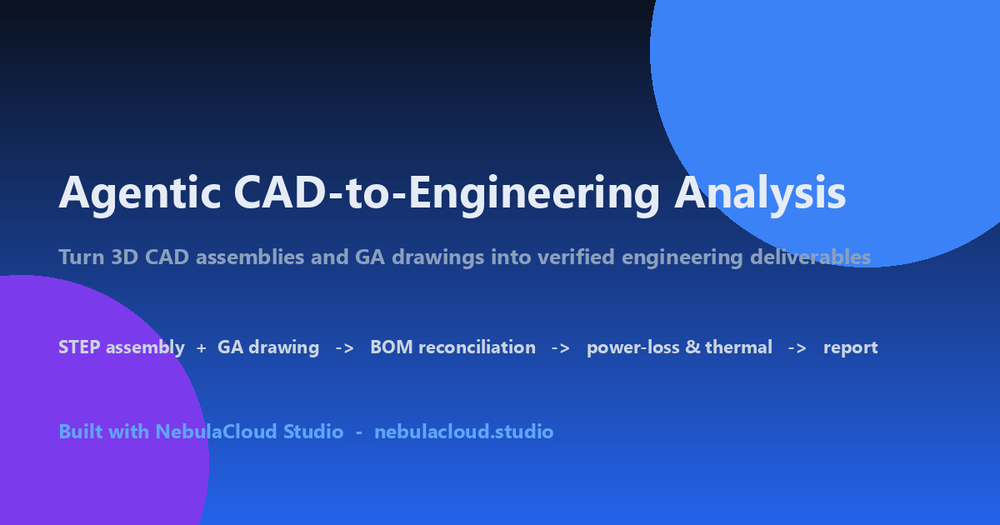

# Agentic CAD-to-Engineering Analysis — Turn 3D CAD Assemblies & GA Drawings into Verified Engineering Deliverables

**Evidence-led interpretation of a real 3D CAD assembly and its general-arrangement drawing — component extraction, BOM reconciliation, power-loss calculation, interactive 3D inspection, and a professional engineering report, executed by natural-language instruction.**

> **Notice** — This repository is a public project showcase created using NebulaCloud Studio. The proprietary source code, implementation details, prompts, workflows, datasets, infrastructure, and deployment configuration are intentionally not included.

---

## Overview

Electrical enclosure and switchgear manufacturers already own 3D CAD models (SOLIDWORKS, Creo, AutoCAD) and detailed GA drawings. The engineering questions they need answered every day — *what components are actually in this model? does the BOM match the drawing? what is the total heat load?* — are still answered by hand.

This showcase demonstrates a single connected workflow that:

1. Reads a STEP (AP203) assembly and extracts its hierarchy, components, dimensions and placements.
2. Reads the GA drawing and extracts the bill of materials, quantities, ratings and losses.
3. Reconciles the two — every drawing line is matched to identified geometry as **confirmed**, **inferred**, or **review**.
4. Reproduces the declared heat-loss subtotal and operating-current reference with source traceability.
5. Presents the assembly in an interactive 3D view (inspect, isolate, select; heat-source and thermal views).
6. Lets an engineer describe the task in plain language and executes the required tools.
7. Emits a professional engineering assessment and structured, reproducible deliverables.

The focus is on **what the application produces** — a traceable engineering result — not on how it is implemented.

---

## Business Problem

Engineering teams face a fragmented, manual workflow:

- **CAD and documents are disconnected.** The 3D model and the GA drawing live in different tools; reconciling them is a tedious visual cross-check.
- **Extraction is error-prone.** Component descriptions, quantities and losses are read out of drawings by hand.
- **Calculations are not traceable.** A heat-loss figure that mixes datasheet values and assumptions looks confident but is not defensible.
- **Review loops are slow.** Discrepancies (an extra component, a mismatched quantity) surface late and require rework.

Without a structured, evidence-led workflow, engineers either over-engineer to be safe or ship with an un-reviewed assumption.

---

## Solution Overview

The workflow turns a CAD assembly and a GA drawing into a reviewable engineering package:

1. **Direct CAD understanding** — import the STEP assembly; extract the product structure, instances, dimensions and placements.
2. **Drawing intelligence** — extract the GA bill of materials, notes and title block.
3. **CAD-to-GA reconciliation** — match expected components to identified geometry with explicit status and exceptions.
4. **Engineering calculations** — deterministic, unit-validated power-loss and current calculations with source traceability.
5. **Interactive 3D inspection** — a consolidated, colour-coded assembly with component selection, isolation, and heat-source/thermal views.
6. **Natural-language execution** — describe the task; the agent invokes the real CAD, document, calculation, visualization and reporting tools.
7. **Professional deliverables** — an engineering assessment report plus structured, reproducible outputs.

---

## Live Demo

[](https://studio-public-demos.github.io/agentic-cad-engineering-analysis/demo.html)

The live demo opens the interactive **3D assembly viewer** — the primary working product:

| Working product | URL |
|---|---|
| **Interactive 3D assembly** (primary) | https://studio-public-demos.github.io/agentic-cad-engineering-analysis/demo.html |
| Showcase site | https://studio-public-demos.github.io/agentic-cad-engineering-analysis/ |

Fully client-side; no backend, no sign-up, no data leaves the browser. Uses a representative (sanitized) example.

---

## Demo Video

A walkthrough of the workflow — CAD import → drawing interpretation → component identification → calculations → 3D inspection → deliverables — is available as a short screen recording (see `assets/videos/`).

---

## Project Screenshots


*(High-resolution captures of the live demo.)*

---

## Generated Outputs

The application produces these deliverables, reproduced here with a representative (sanitized) example:

| Output | Description |
|---|---|
| **Engineering assessment report** | Product details, inputs, methodology, calculations, observations and limitations (PDF). |
| **CAD component inventory** | Extracted assembly hierarchy and component classifications. |
| **CAD-to-GA reconciliation** | Expected vs. identified quantities with match confidence and exceptions. |
| **Power-loss register** | Component-wise losses with quantities and data provenance. |
| **Thermal assessment** | Declared heat-load subtotal and a clearly-labelled preliminary temperature-rise estimate. |
| **Interactive 3D visualization** | Consolidated assembly with linked engineering information. |

All values are representative screening results from a sample scenario; they are not a certified compliance statement.

---

## Key Features

| Capability | Description |
|---|---|
| STEP assembly interpretation | Reads AP203 product structure, instance counts, dimensions and placements directly. |
| Drawing intelligence | Extracts GA BOM tables, notes and title block from the drawing PDF. |
| CAD-to-GA reconciliation | Matches drawing lines to geometry as confirmed / inferred / review, with explicit exceptions. |
| Deterministic calculations | Unit-validated power-loss and current calculations with source traceability and scenario safeguards. |
| Interactive 3D inspection | WebGL viewer — orbit/zoom/pan, per-component selection, isolation, heat-source and thermal views. |
| Natural-language execution | Plain-language instructions invoke real tools (not canned answers). |
| Professional deliverables | Assessment PDF plus structured, reproducible JSON outputs. |

---

## Intended Users

| Audience | Relevant Application |
|---|---|
| Design engineers | Inspect CAD, verify BOMs, review component losses. |
| Thermal / application engineers | Assess enclosure heat load and thermal-design readiness. |
| Engineering managers | Review traceable, reproducible engineering deliverables. |
| Technical reviewers | Check which inputs are declared versus assumed before sign-off. |

---

## Example Use Cases

- Enclosure and switchgear thermal load assessment from existing CAD and drawings.
- CAD-to-BOM reconciliation and design review.
- Solar array junction box (AJB) verification.
- Automated generation of engineering assessment reports from existing models and drawings.
- A natural-language assistant for routine engineering lookups ("show all fuse holders", "reconcile the BOM", "generate the report").

---

## Technical Highlights (High-Level Only)

| Capability | Technology / Method |
|---|---|
| CAD geometry | STEP (AP203) product-structure parsing and boundary-representation geometry processing. |
| Document intelligence | Engineering-drawing table extraction from PDF. |
| Calculation engine | Deterministic power-loss / current calculations with unit validation. |
| 3D visualization | Three.js / WebGL, client-side, responsive, interactive. |
| Agent execution | Natural-language task routing to real engineering tools. |
| Deployment model | Fully static; all computation runs in the browser. |

*(Implementation, prompts, workflows and internal logic are intentionally not included.)*

---

## Architecture Overview (Conceptual Only)

```
Inputs                          Processing                          Outputs
─────────────                   ──────────────────────              ──────────────────────
CAD model (STEP)   ──►  Geometry & assembly extraction  ──►  Component inventory
GA drawing (PDF)   ──►  Document intelligence (BOM)     ──►  CAD-to-GA reconciliation
                                                            Power-loss / current calc
                                                            Thermal readiness
                                                            Interactive 3D assembly
                                                            Engineering report (PDF)
```

This is a conceptual user journey only — it is not an implementation or service-topology disclosure.

---

## Technical Scope & Limitations

- The demonstration reproduces *declared* component losses and reconciles the drawing against the CAD model; it does not invent missing losses.
- A *validated* temperature-rise result (e.g., IEC TR 60890 verification) requires additional inputs — ambient/installation conditions, manufacturer loss-vs-current characteristics, ventilation data, and temperature-rise test data. Where absent, the application reports the gap and provides a clearly-labelled preliminary estimate from public-source assumptions rather than a fabricated result.
- Visualized heat maps represent *declared heat sources*, not a computed thermal field, unless a validated thermal simulation is performed.
- The public sample model and BOM are illustrative and must not be used for real design decisions.

---

## Performance Summary (Verified Only)

The following were reproduced and verified on the sample scenario (12 fuse-protected strings at 12 A, 40.6 W total declared loss, FRP enclosure):

| Quantity | Value |
|---|---|
| STEP assembly import & interpretation | ✅ successful |
| Unique products / assembly groups extracted | ✅ reproduced independently |
| Declared heat-loss subtotal | 40.6 W |
| Operating-current reference | 144 A (12 × 12 A) |
| CAD-to-GA reconciliation | ✅ complete with documented exceptions |
| Interactive 3D visualization | ✅ verified in-browser (no console errors) |
| Natural-language task execution | ✅ real tools invoked |
| Automated validation suite | ✅ all tests passing |
| Responsive (320 / 375 / 768 / 1280 px) | ✅ no horizontal overflow |

These are arithmetic results of the workflow, not physical test measurements.

---

## Attribution

- **Three.js** — WebGL library (MIT), used for the 3D visualization.
- **FreeCAD** — open-source CAD geometry processing (LGPL-2.1-or-later).
- **IEC TR 60890 / IEC 61439-1** — referenced thermal-verification standards, © International Electrotechnical Commission; not reproduced in this repository.
- **Trinity Touch** — publicly documented solar combiner / junction-box products used as an illustrative reference.

Full details and licences are in [ATTRIBUTIONS.md](ATTRIBUTIONS.md).

---

## Built with NebulaCloud Studio

This project was created using [NebulaCloud Studio](https://nebulacloud.studio), an agentic application-building platform for engineering, scientific, geospatial and interactive digital workflows. NebulaCloud Studio helps domain professionals turn ideas, models, datasets and algorithms into usable, deployable applications.

---

## Related Project Showcases

- **Thermal Verification Workbench** — a vendor-neutral enclosure temperature-rise workbench (IEC TR 60890 / IEC 61439-1).
- **Solar Combiner Thermal Engineering** — an evidence-led thermal case study of a published DC combiner box.

Additional engineering, geospatial and interactive showcases are listed on the [Studio demos catalogue](https://studio-public-demos.github.io/).

---

## Call to Action

Working with electrical enclosures, switchgear, or other assemblies that need defensible CAD interpretation and thermal verification?

- Explore the live demo in this repository.
- See the broader portfolio at [studio-public-demos.github.io](https://studio-public-demos.github.io/).
- Discuss a private engineering engagement at [nebulacloud.studio](https://nebulacloud.studio).

---

## License

This repository's license applies only to the showcase materials included here. It does **not** grant rights to the source code, the Studio platform, proprietary workflows, internal prompts, models, datasets, hosted services or trademarks. See [LICENSE](LICENSE).
